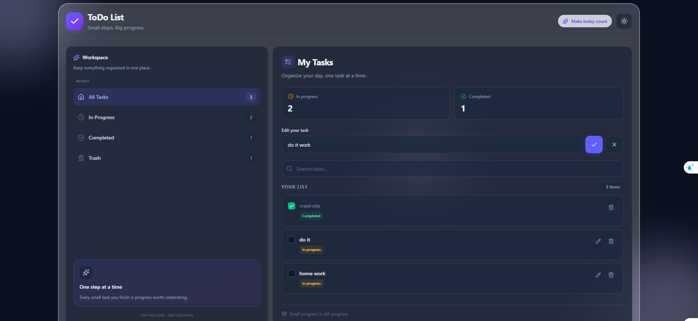

# ✨ Todo List — Stay Productive

A modern, responsive Todo List application built with **Next.js, React, TypeScript, and Tailwind CSS**. Organize your daily tasks, track your progress, and stay focused with a clean interface and persistent local storage.


## 📸 Preview




## 🚀 Features

- **Task Management** — Add, edit, and organize tasks.
- **Progress Tracking** — Mark tasks as completed or in progress.
- **Smart Filtering** — Switch between All Tasks, In Progress, Completed, and Trash.
- **Search** — Quickly find tasks by title.
- **Trash & Recovery** — Restore deleted tasks or permanently remove them.
- **Persistent Storage** — Tasks remain available after refreshing the page using browser `localStorage`.
- **Dark Mode** — Switch between light and dark themes.
- **Responsive Design** — A flexible layout for different screen sizes.
- **Modern UI** — A clean interface with glassmorphism-inspired styling and subtle visual effects.

## 🛠️ Tech Stack

| Technology | Purpose |
|---|---|
| Next.js | React framework |
| React | UI components and state management |
| TypeScript | Type safety |
| Tailwind CSS | Styling and responsive design |
| Lucide React | Icons |
| Browser localStorage | Local task persistence |
| Git & GitHub | Version control |

## 📦 Getting Started

### Prerequisites

Make sure you have Node.js and npm installed.

### 1. Clone the repository

```bash
git clone https://github.com/Hossein-rafiee-esf/todo-list.git
```

### 2. Navigate to the project directory

```bash
cd todo-list
```

### 3. Install dependencies

```bash
npm install
```

### 4. Start the development server

```bash
npm run dev
```

Open [http://localhost:3000](http://localhost:3000) in your browser.

## 📁 Project Structure

```text
todo-list/
├── app/
│   ├── components/
│   │   ├── Left-side/
│   │   │   ├── Header.tsx
│   │   │   ├── Sidebar.tsx
│   │   │   └── AddTask.tsx
│   │   └── TaskContaxt.tsx
│   ├── globals.css
│   ├── layout.tsx
│   └── page.tsx
├── public/
├── package.json
├── package-lock.json
└── README.md
```

## 💾 Data Persistence

Tasks are stored in the browser's `localStorage`, so adding, editing, completing, deleting, and restoring tasks does not require a backend server.

**Note:** Data is stored locally in the current browser. It is not synchronized across devices or browsers.

## 🧠 What I Learned

This project helped me practice:

- Building reusable React components.
- Sharing state between components using React Context.
- Managing task state with `useState` and `useEffect`.
- Creating typed data models with TypeScript.
- Implementing search, filtering, and CRUD operations.
- Persisting client-side data with `localStorage`.
- Building responsive interfaces with Tailwind CSS.
- Using Git and GitHub to manage project changes.

## 🗺️ Future Improvements

- [ ] Add drag-and-drop task ordering.
- [ ] Add task priorities and due dates.
- [ ] Add categories or labels.
- [ ] Add backend storage and user authentication.
- [ ] Deploy the application and add a live demo.

## 👨‍💻 Author

**Hossein Rafiei**

- GitHub: [@Hossein-rafiee-esf](https://github.com/Hossein-rafiee-esf)

---

*Built with ❤️ and a focus on clean UI, usability, and continuous learning.*
